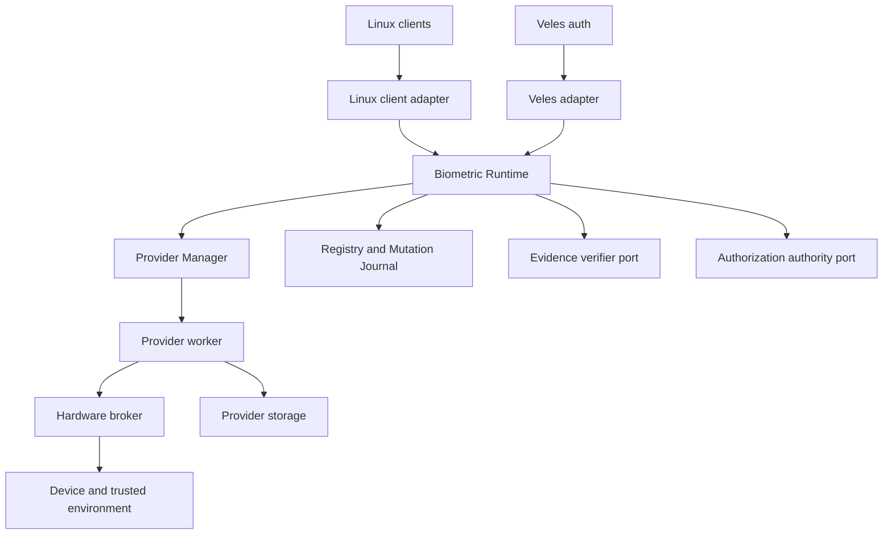

# 02. Компоненты и физическая топология

## Логическая модель

## Ответственность

| Компонент | Владеет | Не владеет |
|---|---|---|
| `carosign-core` | доменными типами, инвариантами | процессами, ОС, аппаратными протоколами |
| `Runtime` | операциями, проверками текущего контекста, планированием, registry state | политикой входа в ОС |
| `ProviderManager` | инвентарём, сопоставлением, запуском и наблюдением providers | неподтверждёнными security assessment |
| `Provider Worker` | конкретной аппаратной сессией, matching/enroll protocol | внешними пользователями и разрешениями |
| `Resource Broker` | гранулярными аппаратными операциями/FD и освобождением | назначением биометрических субъектов |
| `Registry/Journal` | метаданными и durable workflow | обязательным хранением сырых шаблонов |
| `Policy Authority Adapter` | проверкой прав на действие | результатом биометрического matching |
| `Evidence Verifier` | проверкой источника, связности и свойств evidence | автоматическим разрешением входа |
| `Interaction Controller` | временной координацией подсветки/тача/прогресса | правом решать результат matching |
| `Platform Adapter` | учётными записями, авторизацией, IPC и сессиями ОС | реализацией алгоритмов датчиков |

## Физическое размещение для Linux

- `carosignd` — процесс с Core/Runtime/ProviderManager/Registry/Journal и проверкой клиентских запросов.
- `bio-provider-*` — отдельные workers, как правило один на независимо изолируемый сенсор.
- `hardware-broker` — отдельный процесс или ограниченные вызовы, если требуется привилегированный UAPI.
- `secure-listener` — долгоживущий процесс со своим состоянием, если доверенная среда требует FS/GPFS/RPMB callbacks.
- UI и PAM — клиенты, не имеющие права прямого доступа к аппаратуре или шаблонам.

Процессная топология не является доменным контрактом: Veles может размещать Runtime внутри собственной системной ячейки, используя Uzel и владельцев устройств.

## Потоки

- Control: запрос → авторизация → операция → provider → результат → verifier/authority → потребитель.
- Hardware: ProviderManager → broker/lease → worker → device/TEE.
- Persistence: intent → worker mutation → independently reconcilable outcome → registry commit → journal completion.
- Interaction: operation → bounded prompts → platform interaction lease → close/quiesce.

## Anti-patterns

Не позволять каждому provider открывать публичный сокет. Не загружать сторонние `.so` внутрь привилегированного `carosignd`. Не привязывать базовую модель к `/dev/tee0`, `gxfp` или libfprint. Не создавать 7 обязательных демонов только потому, что существует 7 логических портов.
