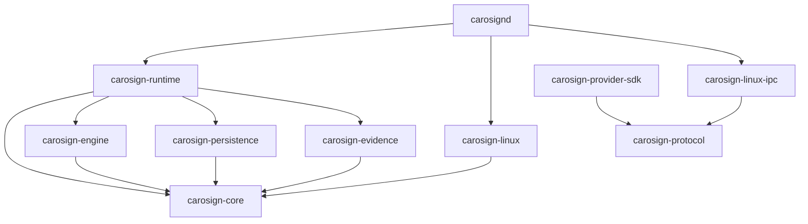

# 02. Зависимости между Rust-проектами

## Логический DAG

No dependency arrow from the core/runtime to any concrete hardware provider. `carosign-protocol` contains wire types only; mapping `wire ↔ core` belongs to adapter modules (e.g., `carosign-linux-ipc::mapping`, `carosign-provider-sdk::mapping`). This avoids forcing the core into protobuf types.

## Logical ports vs transport

| Domain operation | Port owner | Typical implementation |
|---|---|---|
| `Authorize/Validate/WatchRevocation` | runtime authz | Linux polkit bridge / Veles authority |
| `Discover/ClaimResource/Release` | runtime resource orchestration | Linux broker / Veles resource service |
| `ExecuteProviderCommand` | runtime worker supervisor | private seqpacket link |
| `MutationJournal/Registry` | persistence | redb-backed state store |
| `EvaluateEvidence` | evidence | software report trust / TEE verifier |
| `Time/BootIdentity` | runtime time | CLOCK_BOOTTIME + boot id |
| `SendInteractionEvent` | runtime interaction | D-Bus/UI subscriber / Veles Yav |

## Disallowed dependency examples

- `carosign-core` importing `prost` or `tokio` → prohibited.
- `carosign-runtime` importing Goodix command numbers, libfprint `FpPrint`, or NPU-specific types → prohibited.
- `carosign-persistence` deciding PAM authentication result → prohibited.
- `carosign-provider-sdk` importing `carosignd::authz` → prohibited.
- `carosign-linux` importing Veles `Uzel` → prohibited.
- `carosignd` reading raw fingerprint frames → prohibited by normal operations (diagnostics separate).

## Concurrency boundary

Pure engine transitions are sequential and deterministic. Runtime owns per-operation mailbox, serializes transitions, and initiates effects. Worker supervision, cancellation and resource release happen outside pure engine. A slow or blocked device must not hold a lock covering all operations.

## Facade and re-export policy

- `core::prelude` limited to stable identifiers and request/result domain types; no blanket `pub use *`.
- `runtime::RuntimeHandle` is a narrow handle; composition root constructs `RuntimeBuilder` with required ports.
- `protocol` generated fields are not public Rust semantic traits.
- SDK developers depend on generated wire + convenience wrapper, **never** on core internal source layout.
