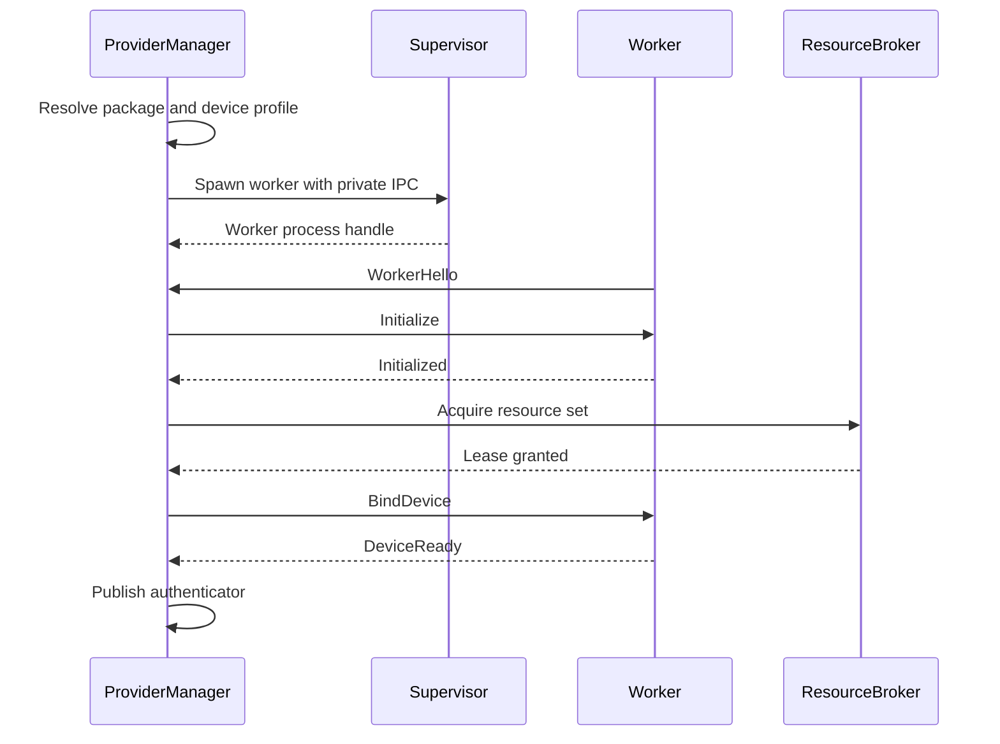
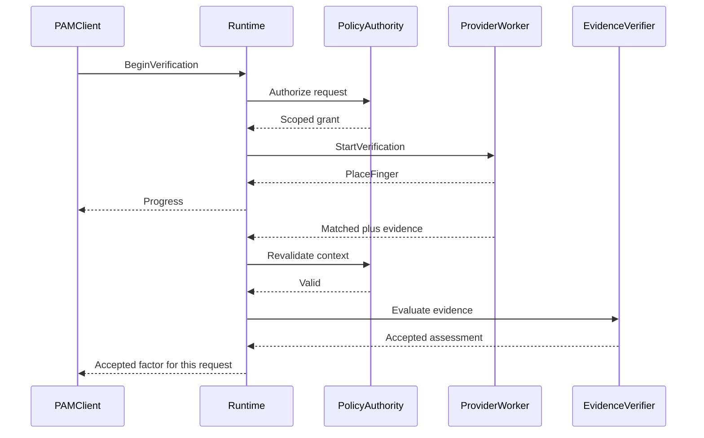
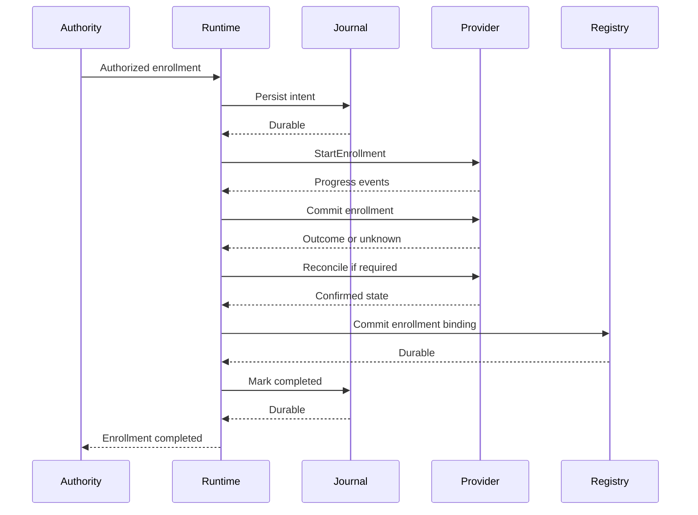
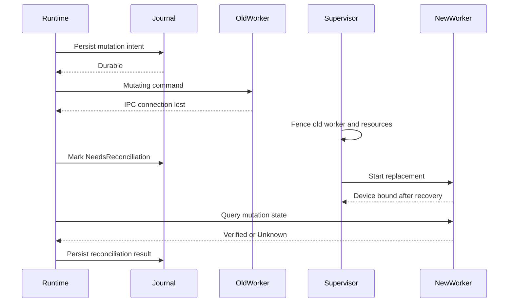
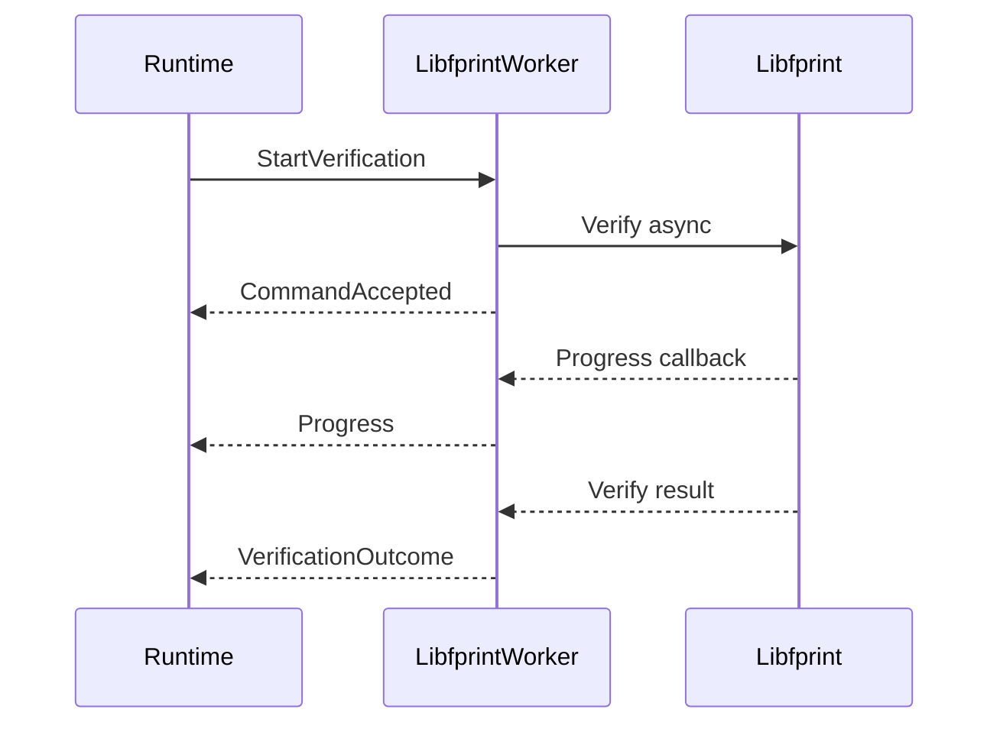

# P6. Сквозные сценарии взаимодействия

Диаграммы Mermaid намеренно простые, без HTML и нестандартных токенов.

## A. Запуск стороннего провайдера

## B. Linux PAM verification

Этот сценарий не обещает hardware evidence GXFP: Policy может принять software factor при соответствующей конфигурации.

## C. Enrollment и durable commit

При потере worker до подтверждения outcome применяется `NeedsReconciliation`, а не повтор `Commit enrollment`.

## D. Сбой worker при мутирующей операции

Если `Unknown`, конфликтующая регистрация остаётся заблокированной. Живость нового worker не доказывает безопасного состояния TA.

## E. libfprint bridge

`GCancellable` может запросить отмену, но quiesce требует подтверждённого завершения операции.
